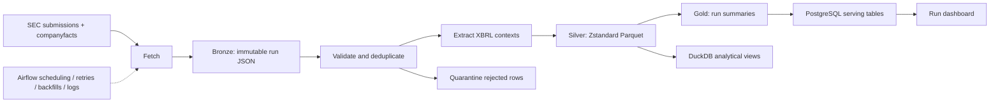

# FilingFlow

A local SEC financial-data pipeline with Apache Airflow, a Parquet/DuckDB analytical lake, PostgreSQL serving tables, and a live run dashboard. No paid services or cloud account required. Docker Desktop licensing depends on your organization; the application stack uses open-source technologies.

## Start

Install Docker with Compose v2 and allocate at least 4 GB RAM (8 GB preferred).

```sh
make start
```

The startup command creates `.env` from the demo defaults if missing, preserves existing settings, builds and starts all services, and waits for the dashboard, database, and Airflow scheduler to be ready. Start Docker Desktop first. `make up` is an alias for the same command.

Wait briefly for DAG discovery after startup.

- Dashboard: http://localhost:8501
- Airflow: http://localhost:8080 — local credentials `admin` / `admin`

```sh
make trigger      # deterministic synthetic data; includes a duplicate
make retry        # fails the first fetch attempt, then recovers
make failure      # exhausts retries, records an alert
make backfill     # three daily historical intervals, January 1–3, 2025
make test
make query
```

The DAG runs at 06:00 UTC daily with catchup disabled. Backfill explicitly processes historical daily data intervals. Filings are selected by filing date in `[interval_start, interval_end)`. A manually triggered run uses Airflow's inferred completed interval; use backfill for exact historical dates. Backfill uses the environment's configured mode; keep `FILINGFLOW_MODE=demo` for the demonstration.

## Architecture



Airflow tasks: `begin → fetch_filings → validate_deduplicate → extract_metrics → publish_lakehouse → load_postgres → publish_dashboard`.

- **Bronze:** complete fetched JSON in per-run hashed artifact directories under `/opt/airflow/data`. Artifacts include `bronze.json`, `validated.json`, `quarantine.json`, and `extracted.json`. Same-run retries replace artifacts atomically; distinct runs retain independent snapshots.
- **Silver:** typed filings and metrics in `/opt/airflow/data/lake/silver/mode=…/run=…/*.parquet`.
- **Gold:** one run summary Parquet file per run under `lake/gold`. Query historical summaries directly with DuckDB.
- **DuckDB:** embedded SQL over Parquet; no server or paid warehouse. `filingflow.lakehouse.query()` exposes deduplicated `filings` and `metrics` views. This is a small file-based analytical lake, without Iceberg/Delta transactions, catalog, or time-travel APIs.
- **PostgreSQL:** `runs`, `filings`, `metrics`, and `alerts`. Demo and live data use separate keys. Filing identity is `(mode, cik, accession)`; metric identity also includes metric and period. Loads are transactional and replace a filing's metric contexts on replay.
- **Serving:** lightweight Python HTTP dashboard reads PostgreSQL every 15 seconds. Recent runs, success rate, metrics, and failure alerts are visible. Airflow provides actual task attempts and logs.

The named Docker volumes persist database state, logs, and pipeline artifacts across restarts. `docker compose down` preserves them. Removing volumes deletes the project data.

## Live SEC mode

Edit `.env`:

```dotenv
FILINGFLOW_MODE=live
SEC_USER_AGENT=FilingFlow Your Name your-real-email@your-domain.com
FILINGFLOW_CIKS=0000320193,0000789019
```

Then `docker compose up -d --force-recreate`. The next scheduled run uses live data; trigger with `--conf '{"mode":"live"}'` to override the mode. No SEC API key is needed. Use a real descriptive contact User-Agent. Requests are serial, spaced at least 250 ms apart, and task-level retries use exponential backoff. Do not scale fetch tasks without a shared rate limiter. HTTP errors, including 403/429, fail visibly and are retried by Airflow.

Uses the SEC submissions and companyfacts JSON APIs, including historical submissions pages when their date ranges overlap the requested interval. It retrieves filing metadata and structured XBRL facts, not full filing HTML. Raw API responses are retained for replay and audit.

## Metric semantics and quality

Extracts USD revenue, net income, and assets from standard US-GAAP concepts, matched to the filing accession and report end date. Revenue uses an ordered tag fallback. Duration facts retain their start and end dates: quarter and YTD values remain separate. Assets are instantaneous. Duplicate identical contexts collapse; conflicting values fail extraction. Missing metrics are recorded, not converted to zero. Custom taxonomy, IFRS, non-USD facts, and metrics not exposed by companyfacts are outside this project's scope.

Validation checks accession format, CIK, ISO dates, supported 10-K/10-Q form, and primary document. Invalid rows are written to a quarantine artifact and fail the quality gate. Batch duplicates are counted before extraction; database uniqueness makes repeated runs idempotent. Amendments are not currently ingested.

## Observe orchestration

1. Run `make retry`. In Airflow, open the DAG Grid, select `fetch_filings`, and inspect attempt 1 (intentional failure) and attempt 2 (success).
2. Run `make failure`. After three attempts, the task turns red. An alert and failed run appear in the dashboard. Downstream tasks do not run.
3. Run `make backfill`. Inspect separate historical run intervals and query the lake with `make query`.
4. Repeat a run/backfill. PostgreSQL retains one filing per accession and mode; run history and Parquet run snapshots retain lineage.

Task defaults: two retries, initial 20-second delay with exponential backoff, 20-minute task timeout, one active DAG run. Airflow logs are stored in a persistent volume and exposed in its UI.

For external failure notification, set `ALERT_WEBHOOK_URL` to an endpoint accepting JSON with `text`, `run_id`, and `task_id`, then recreate containers. No message is sent until you configure an endpoint and a task exhausts retries. Every callback first records a local alert; delivery failures remain visible in scheduler logs and the alert's `delivered` flag. Database outages can prevent recording alerts; error logs remain the fallback. The callback has no durable delivery queue.

## Development and verification

```sh
make test
docker compose exec scheduler airflow dags list-import-errors
docker compose exec scheduler airflow dags test filingflow 2025-01-02
```

Tests cover duplicate removal, quarantine, missing metrics, distinct duration contexts, conflicting facts, malformed SEC columns, and Parquet replay/deduplication. CI runs unit tests and validates Compose. Full service verification requires Docker.

Local development defaults bind HTTP ports to loopback and use sample credentials. Production deployment requires proper secrets, authentication/TLS, managed backups, object storage, and an operational alert transport. Airflow 2.10.5 is pinned for this reproducible local demo; evaluate a supported release and migration before production use. PostgreSQL and the lake are not a distributed transaction: lake snapshots may exist for failed runs; dashboard success is recorded only after both outputs finish.

References: [SEC APIs](https://www.sec.gov/search-filings/edgar-application-programming-interfaces), [Airflow Docker setup](https://airflow.apache.org/docs/apache-airflow/2.10.5/howto/docker-compose/index.html), [DuckDB Parquet](https://duckdb.org/docs/stable/data/parquet/overview).
